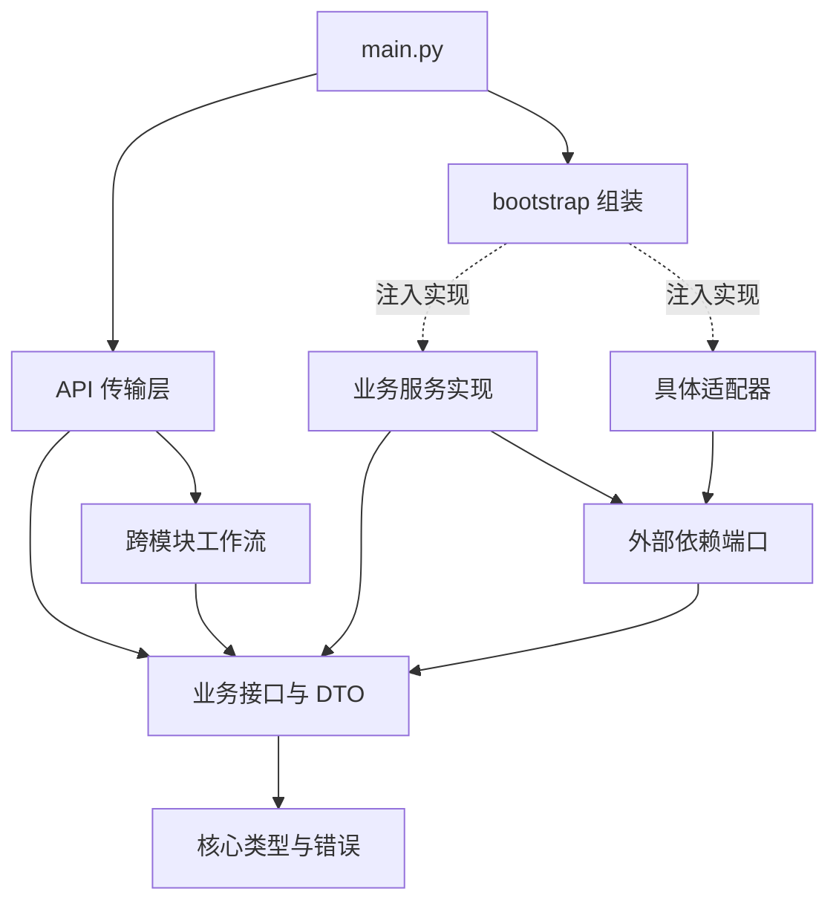

# Atoms Demo 模块设计

## 1. 需求理解与设计边界

[README.md](README.md)是功能范围的依据。本设计将其中的前端、后端、外部接入和验收要求分配到独立模块，允许各模块根据接口分别实现，再由工作流集成。

必须实现的产品范围包含账户、工作区、项目、模板与公开内容、设置、费用、连接器、存储、Agent 生成、代码与版本、预览、应用资源以及发布管理。唯一明确暂缓的是基础设施自动执行适配器：自动开通云资源、远程部署、DNS 和证书自动化。发布界面、配置保存、状态及人工部署结果管理不暂缓。

**设计阶段建立的业务契约仍不是完成的产品功能。**T01 基础设施及可构建前端壳已按 [docs/T01-foundation.md](docs/T01-foundation.md) 实现；业务服务仍为显式 `FeatureNotImplemented`，HTTP 路由对未实现业务返回 501，不返回虚假的成功结果。

技术边界：

- Python 负责业务服务、工作流、API、存储与外部服务适配。
- 浏览器 UI 独立放在 `frontend/`，采用 React/TypeScript 的组件边界；浏览器代码不能放入 Python 业务模块。
- 生成的应用是产品输出，保存在受管理的版本与产物存储中，不混入平台源码。
- 原站前端观察不等于原站后端源码；本设计是本项目的实现方案。
- README 的完整范围优先于旧分析报告中的最小化实现建议及旧交付计划。

## 2. 总体结构与依赖方向

采用模块化单体，先通过代码和数据所有权隔离职责，不要求每个模块独立部署。



静态依赖规则：

1. `core` 只依赖标准库与自身。`contracts` 只依赖 `core`，不同业务契约不互相导入。
2. `ports` 依赖 `core/contracts`，只定义抽象端口及具名依赖集合。
3. `services/<module>.py` 只依赖自己的契约、`core` 和 `ports`，禁止导入其他业务服务、API、工作流或适配器。
4. `workflows` 通过业务 Protocol 调用模块，禁止导入具体 `services` 或 `adapters`。工作流可以使用自己的流程 DTO。
5. `adapters` 实现端口，不导入业务服务或工作流；授权适配器读权限数据，不能反向调用工作区业务服务。
6. `api` 只做认证上下文建立、输入校验、调用接口、序列化及 HTTP/SSE 映射。禁止 SQL、模型 SDK 和业务状态转换。
7. `bootstrap.py` 是唯一组装入口；其他模块不得反向导入它。`main.py` 只依次加载配置、组装应用、启动服务。
8. 前端 `features/*` 不互相导入，公共传输放 `api/`，跨功能布局由 `app/` 组合。

模块间用 ID、不可变 DTO 和明确接口通信，不共享可变服务实例内部状态，不通过全局 service locator 查找依赖。

## 3. 模块划分与数据所有权

每个业务模块对应同名的 `contracts/<name>.py` 与 `services/<name>.py`。前者定义数据与公共方法，后者实现自己的业务规则。数据库可以共用，但各模块只能写自己拥有的表。

| 模块 | 唯一职责与拥有的数据 | 主要输入 → 输出 | 不负责的内容 |
|---|---|---|---|
| `identity` | 用户身份、密码摘要、会话、验证令牌、OAuth 登录事务 | `Credentials / VerificationRequest / OAuthCallback` → `User / Session` | 头像偏好、成员角色、连接器绑定 |
| `workspaces` | 工作区、成员、角色、邀请与工作区选择 | 名称、邮箱、`Role` → `Workspace / Membership / Invitation` | 用户密码、项目内容、账单 |
| `profiles` | 公开资料、头像引用、语言、模型与通知偏好 | `Profile / Preferences` → 更新后的 DTO | 邮箱变更与验证归 identity；公开作品归 catalog |
| `projects` | 项目身份、归属、名称、可见性及用户项目收藏 | `CreateProject / ProjectQuery` → `Project / Page[Project]` | 当前成功版本指针、文件内容、生成任务 |
| `catalog` | 发现内容、模板条目、分类、公开统计及内容收藏 | `CatalogQuery / CatalogEntry` → 条目、分页、分类 | 项目复制、版本复制、源项目私有权限 |
| `billing` | 套餐、订阅、发票、构建积分、钱包账本、用量预留与结算 | `Money / UsageCharge` → `Checkout / Balance / LedgerEntry` | 物理存储配额、Agent 调度、支付凭据明文 |
| `connectors` | 连接器授权事务、授权状态、凭据引用与项目绑定 | 提供商、回调、项目 ID → `Connector` | 平台登录身份、通用 SecretStore 实现 |
| `storage` | 附件、文件元数据、物理配额、存储用量与删除策略 | `Upload / Scope` → `StoredObject / StorageUsage` | 文件版本语义、业务数据库、费用入账 |
| `conversations` | 消息及对话摘要 | `AppendMessage` → `Message`；项目 ID → 历史 | 执行任务或直接调用模型 |
| `tasks` | 持久任务、状态转换、尝试次数、事件序列与恢复 | `SubmitTask / TaskTransition` → `Task / TaskEvent[]` | 模型生成、构建、版本晋升 |
| `generation` | 模型选项、提示上下文、结构化文件变更与修复请求 | `GenerationInput / RepairInput` → `FileChangeSet` | 任务状态持久化、写版本、执行 shell |
| `builds` | 受控构建与产物扫描的业务校验 | `BuildInput` → `BuildResult`；产物 → `ScanResult` | 业务代码生成、域名、生产发布 |
| `versions` | 不可变文件清单、候选版本、构建关联、成功版本指针、导出 | `CreateVersion / EditVersion / PromoteVersion` → `Version / ProjectHead` | 业务记录回滚、实际构建、生产版本 |
| `preview` | 预览票据、分享凭据、撤销、运行错误接收 | 项目与版本 ID → `PreviewTicket / ShareLink` | 改代码、持久业务记录、生产发布 |
| `app_resources` | 生成应用的资源配置、应用用户／会话、业务记录、环境与密钥引用 | `AppResource / AppDataContext / AppRecord` → 配置、会话与记录 | 平台用户登录、平台源码版本、云资源自动创建 |
| `publication` | 生产版本关联、发布配置、域名记录、人工结果核验、发布状态 | `PublicationConfig / ManualDeploymentResult` → `Publication` | 生成与预览、创建服务器、DNS 自动执行 |

特别明确以下边界：

- `profiles` 的邮箱展示来自 identity；只有 identity 能修改和验证邮箱。
- `projects` 不保存第二份当前版本；`versions.ProjectHead` 是当前成功预览版本的唯一权威。
- `publication.version_id` 是选定生产版本，与预览头指针独立。
- 项目收藏归 projects；公开内容／模板收藏归 catalog，二者不是同一关系。
- storage 统计字节数、限制物理配额；billing 记录钱或积分、执行费用预留和结算。存储服务不得自行写账本。
- 任务、对话、版本、业务数据分别有自己的生命周期，不能用一个 JSON 字段混装所有状态。
- 预览与生成应用用户身份不能复用平台会话；恢复源码不自动回滚业务记录。
- 密钥只在 `SecretStore` 内解析，其他模块保存 `SecretRef`；前端不能收到密码、OAuth token 或密钥明文。

### 3.1 依赖注入边界

每个服务构造函数接受一个具名依赖 DTO，例如 `IdentityDependencies`，而非包含所有功能的万能容器。各 DTO 定义在 `ports/dependencies.py`。

所有服务可以使用 UoW、授权、时钟与 ID 端口；其他端口按下表分配：

| 服务 | 专属可用端口 |
|---|---|
| identity | SecretStore、MailProvider、CaptchaProvider、OAuthProvider |
| workspaces | MailProvider |
| profiles / projects / catalog / conversations | 无额外提供方 |
| publication | DeploymentVerifier（只读核验，不创建资源） |
| billing | PaymentProvider |
| connectors | OAuthProvider、SecretStore |
| storage / versions / preview | BlobStore |
| tasks | EventStore、JobQueue |
| generation | ModelProvider |
| builds | BuildExecutor |
| app_resources | BlobStore、SecretStore |

接口实现时可以进一步删去无用依赖，不能为了跨模块调用而新增 sibling service 注入；跨模块需求进入工作流。

## 4. 目录结构

```text
.
├── README.md                    # 产品范围，不记录排期
├── DESIGN.md                    # 本设计
├── main.py                      # 配置 → 组装 → 启动
├── pyproject.toml               # Python 包边界，骨架无第三方运行依赖
├── .env.example                 # 配置名称示例，不含凭据
├── atoms_demo/
│   ├── config.py                # Settings 与环境加载接口
│   ├── bootstrap.py             # 唯一 composition root
│   ├── core/                    # ID、上下文、分页、错误、任务事件
│   ├── contracts/               # 16 个领域 DTO 与 Protocol
│   ├── ports/                   # 持久化、运行时、提供方、具名依赖
│   ├── services/                # 16 个独立业务实现占位文件
│   ├── workflows/
│   │   ├── registry.py          # 按流程划分的抽象接口集合
│   │   ├── generation.py        # 生成、修改与手动编辑编排
│   │   ├── project_lifecycle.py # 模板实例化／克隆／Remix、恢复
│   │   ├── publication.py       # 发布前检查与人工发布编排
│   │   ├── preview.py           # 版本授权、分享及应用会话组合
│   │   └── dashboard.py         # 工作台只读数据组合
│   ├── adapters/               # 各外部端口独立实现入口
│   └── api/
│       ├── application.py       # 对传输层暴露的应用接口集合
│       ├── routes.py           # 版本化 HTTP 路由与目标方法目录
│       ├── serialization.py    # DTO／错误编码边界
│       └── server.py           # HTTP、认证、SSE 与静态资源挂载
├── frontend/
│   ├── README.md               # 前端边界说明
│   └── src/
│       ├── app/App.tsx         # 路由与全局设置浮层组合
│       ├── api/client.ts       # 统一请求、会话与错误传输
│       └── features/           # auth、dashboard、projects、catalog、
│                               # profile、settings、billing、connectors、
│                               # storage、members、editor、history、
│                               # preview、resources、publication
├── docs/contracts-index.json   # README 模块／F01–F13 与接口映射
├── tests/test_architecture.py  # 导入、签名、覆盖、分层、循环检查
└── analysis/                   # 已有只读研究与 REA 证据，不是运行时依赖
```

初始骨架不包含数据库迁移或 API 服务器。T01 已选择 SQLite 迁移与标准库 HTTP 传输，并在适配器与 API 层实现基础能力；模型 SDK 等 T05 后续选型不得改变业务接口来迎合 SDK。

## 5. 接口定义与输入输出

### 5.1 统一数据契约

所有领域 DTO 使用 `dataclass(frozen=True, kw_only=True)`。模块接口使用 `typing.Protocol`；实现类保持一致签名。各接口文件可直接作为独立开发依据。

| 核心结构 | 字段／语义 |
|---|---|
| `RequestContext` | `actor_id, session_id, workspace_id, request_id`；由认证传输层建立，不接受客户端冒充身份 |
| `Scope` | `workspace_id, project_id`；用于仓储隔离，不代替授权检查 |
| `Mutation` | `idempotency_key, expected_revision`；防重复操作及并发覆盖 |
| `PageQuery / Page[T]` | `cursor, limit` → `items, next_cursor`；游标不暴露 SQL 或跨租户位置 |
| `BlobRef` | `id, sha256, size_bytes, media_type`；不暴露任意宿主文件路径 |
| `SecretRef` | 密钥标识；禁止在响应中解析成凭据 |
| `Task` | 关联工作区／操作者／项目，持久化 SubmitTask（含消息、模式、模型、基线版本及头 revision），另存状态、修复次数、结果版本和 revision |
| `FileChangeSet` | 变更摘要、完整的待替换文件、删除路径、模型用量 |
| `Version / ProjectHead` | 不可变源码／产物清单；成功头指针独立带 revision |
| `Money` | 整数最小货币单位与货币代码，禁用浮点费用 |
| `LedgerEntry` | 账户类别、单位、增减量、源事件；积分和货币不混算 |
| `AppDataContext` | 项目、应用用户与环境；和平台用户上下文分开 |
| `Publication` | 项目、生产版本、环境、域名、数据选项、真实状态与执行方式 |

`AppRecord.json_document` 是应用业务内容的 JSON 文本边界，不是任意平台字段字典；app_resources 必须校验 JSON、大小、集合规则和 schema_version。URL 中的资源 ID 与请求体 ID 不一致时拒绝请求。

### 5.2 业务模块接口索引

完整签名、必填输入与返回类型位于对应 Python 文件；下表指出主要入口及结果，不以“通用 handle(dict)”代替模块契约。

| 接口 | 主要方法 | 输入 → 输出契约 |
|---|---|---|
| [IdentityAPI](atoms_demo/contracts/identity.py) | check_email、register、login、request_verification、verify、oauth_start/callback、change_email、logout | 邮箱／Credentials／回调 → EmailCheck、User、Session |
| [WorkspaceAPI](atoms_demo/contracts/workspaces.py) | create/list/select、members、invite/accept、change_role/remove | 工作区 ID、邮箱、Role、Mutation → Workspace、Membership、Invitation |
| [ProfileAPI](atoms_demo/contracts/profiles.py) | get/update、preferences/save_preferences | 用户 ID 或 Profile/Preferences → 同类型保存结果 |
| [ProjectAPI](atoms_demo/contracts/projects.py) | create/get/list、rename、set_visibility、set_favorite | CreateProject／查询／ID → Project 或分页 |
| [CatalogAPI](atoms_demo/contracts/catalog.py) | search/detail/categories、save、record_view、publish_entry | 查询／条目 ID → CatalogEntry、分页或分类 |
| [BillingAPI](atoms_demo/contracts/billing.py) | plans/subscription/checkout/top_up/balances/ledger/invoices、reserve/settle/release、handle_webhook | 金额／预留／用量／签名事件 → 订单、账目和回执 |
| [ConnectorAPI](atoms_demo/contracts/connectors.py) | list、authorize/callback、bind/revoke | 提供商／回调／项目绑定 → Connector 或授权地址 |
| [StorageAPI](atoms_demo/contracts/storage.py) | upload/get/download/list/delete、usage、set_pay_as_you_go | Upload／Scope／ID → StoredObject、bytes、StorageUsage |
| [ConversationAPI](atoms_demo/contracts/conversations.py) | append/history/summarize | AppendMessage／项目 ID → Message、历史、摘要 |
| [TaskAPI](atoms_demo/contracts/tasks.py) | submit/get/transition、events/append_event、cancel/recover_interrupted | SubmitTask／TaskTransition → Task、事件 |
| [GenerationAPI](atoms_demo/contracts/generation.py) | models、generate、repair | GenerationInput／RepairInput → FileChangeSet |
| [BuildAPI](atoms_demo/contracts/builds.py) | build、scan | BuildInput／产物引用 → BuildResult、ScanResult |
| [VersionAPI](atoms_demo/contracts/versions.py) | head/get/list/read_file、create_candidate/edit_candidate、record_build、promote、export | 文件清单／编辑／CAS 请求 → Version、ProjectHead、文件内容、导出 BlobRef |
| [PreviewAPI](atoms_demo/contracts/preview.py) | issue/resolve_ticket、serve_artifact、report_issue、create/revoke/resolve_share | 内部 PreviewGrant／票据／问题 → PreviewTicket、产物字节、ShareLink、回执 |
| [AppResourceAPI](atoms_demo/contracts/app_resources.py) | resources/configure/set_secret、open/authenticate_app、records/put/delete | 资源配置／应用会话／业务记录 → 配置、AppSession、AppRecord |
| [PublicationAPI](atoms_demo/contracts/publication.py) | configure/get/request_manual/verify_manual_result/change_state | PublicationConfig／人工结果 → Publication |

公开业务方法不是全部都公开为 HTTP 端点。`transition`、`promote`、`settle`、`record_build` 等仅由可信工作流调用。浏览器不能直接将任务改成成功、修改余额或将未构建版本设为成功版本。

### 5.3 跨模块接口

| 工作流 | 输入 | 输出 | 调用范围 |
|---|---|---|---|
| `GenerationWorkflow.submit` | RequestContext、GenerateApplication | Task（排队） | 项目、版本、消息、任务、计费 |
| `GenerationWorkflow.run` | 服务端重建的上下文、task_id | Task（最终状态） | 上述模块及生成、存储、构建 |
| `GenerationWorkflow.edit` | RequestContext、EditVersion | Task | 版本、任务、构建；可视化编辑转换为相同 FileEdit |
| `ProjectLifecycle.clone` | CloneProject | 新 Project | 模板／公开权限、项目、版本 |
| `ProjectLifecycle.restore` | PromoteVersion | ProjectHead | 项目与版本；不调用业务记录回滚 |
| `PublicationWorkflow.prepare` | PublicationConfig | Publication | 版本、扫描、资源、发布配置 |
| `DashboardQueries.project` | project_id | ProjectOverview | 组合 Project、ProjectHead、Balance，只读 |
| `PreviewWorkflow.open/share` | 项目、版本、Mutation | PreviewTicket／ShareLink | versions 校验成功版本，preview 签发访问能力 |
| `PreviewWorkflow.app_session` | preview_token、existing_app_token | AppSession | preview 校验票据，app_resources 复用或建立应用身份 |

克隆、Remix、使用模板共享 `clone`，通过 `source_entry_id` 区分来源；不复制源项目密钥、成员、钱包或业务记录。

### 5.4 HTTP 与事件契约

完整方法与路径目录见 [api/routes.py](atoms_demo/api/routes.py)，全部业务 URL 位于 `/api/v1` 下。路由记录指向抽象接口方法，不包含业务逻辑，也不代表端点已启动。

约定：

- 读取返回 `200`；新资源返回 `201`；异步生成、编辑任务返回 `202` 及 Task；无返回值的成功写入返回 `204`。
- 数据直接使用相应 DTO，分页固定 `items/next_cursor`。枚举为字符串，时间为带时区 UTC ISO 8601，二进制通过下载接口返回。
- 错误为 `ErrorResponse(code, message, request_id, retryable)`；校验／认证／权限／不存在／冲突／超额／依赖不可用分别映射 `422/401/403/404/409/429/503`；未实现返回明确 `501`，绝不伪造成功。
- `Idempotency-Key` 对应 Mutation；工作区由已认证会话及受验证选择确定。任何请求的资源归属仍要在服务端检查。
- Session 认证通过 HttpOnly cookie；状态写入必须有 CSRF 防护。平台与预览跨域策略只允许配置的来源，不使用宽泛凭据 CORS。
- OAuth state/PKCE、邮箱令牌有效期／单次消费、验证码重放限制由 identity/connectors 实现，不由前端判断。
- 支付 webhook 验签后才可交给 billing；按提供方 event_id 去重，不能依赖回跳页面判定付款。
- `GET /tasks/{task_id}/events` 以 SSE 传输持久 TaskEvent；`Last-Event-ID` 映射 sequence，断线按游标续读；数据流不展示模型隐式推理或原始凭据。
- 公共目录、公开资料、分享和预览有独立访问策略；匿名浏览不等于绕过源项目权限。

请求示例（用于接口形状，不是已可调用端点）：

```json
{
  "project_id": "project-example",
  "prompt": "增加按状态筛选，保留原数据",
  "attachment_ids": [],
  "model": "configured-model",
  "agent_mode": "standard",
  "expected_head_revision": 3,
  "mutation": {
    "idempotency_key": "client-operation-example",
    "expected_revision": 3
  }
}
```

以上请求进入 `GenerationWorkflow.submit`，不是直接暴露 ModelProvider。响应为 Task，包含 task_id、state 和基线版本，前端再订阅事件与获取预览。

## 6. 调用流程与一致性

### 6.1 登录、工作区及设置

1. API 建立匿名或已认证 RequestContext，identity 执行邮箱检查、登录或验证，成功后传输层设置会话 cookie。
2. workspaces 返回可访问工作区并校验选择；授权适配器根据成员关系验证后续操作。
3. profiles 管理资料／偏好；邮箱修改走 identity。设置面板只是 UI 容器，各页调用自己所属模块。

### 6.2 生成与追加修改

1. 工作流验证项目权限及 expected_head_revision，记录用户消息与可重放的 SubmitTask。
2. 同一项目只允许一个活动修改任务；重复幂等请求返回既有任务，其他重叠修改返回 `409`。不同项目可在限额内并行。
3. billing 预留用量。tasks 在本地事务中持久化任务及 outbox，worker 根据队列 lease 执行；提交前后失败均应能重试或补偿，不假定跨模块分布式事务。
4. 工作流获取历史摘要、基线文件与附件，转换成 GenerationInput 调用 generation。
5. 校验路径与依赖后写入候选版本，builds 调用隔离构建端口；不让模型控制宿主 shell。
6. 编译错误进入 repair，最多两次。失败记录诊断并保留旧头；成功关联产物后以 CAS 晋升 ProjectHead。
7. billing 按实际用量幂等结算，未消费预留释放；任务记录结果、生成摘要和事件。重试不能重复收费或复制成功版本。

工作流负责顺序与补偿，业务服务负责本模块不变量；跨模块不直接写表。首次业务事务实现时应以持久 saga/checkpoint 记录已完成步骤，服务重启后继续或明确标记 interrupted，不能永久停在 generating。

worker lease 过期的旧任务不得覆盖新头。Task 必须持久保存提交参数与操作者，worker 重启后能重建输入并重新检查授权，不能依赖浏览器或旧进程内存。即使前端中途离开，任务、事件和成功成果仍以服务端状态为准。

### 6.3 文件编辑、恢复与导出

手动源码编辑与可视化编辑都产生 EditVersion，走相同候选版本、构建、CAS 晋升流程。visual editor 只负责选中元素、提出变更和转换编辑请求，不自建第二套文件存储。

恢复选择已知成功版本，只改变成功头及记录审计；不删除历史、不改变 production 版本、不回滚 AppRecord。导出由 versions 生成包含源码和必要模板配置的归档，BlobStore 仅保存字节。

### 6.4 预览、应用数据与分享

PreviewWorkflow 先通过 versions 验证授权与构建产物，再创建内部 PreviewGrant 交给 preview 签发短期票据。客户端不得提交 grant 或 artifact 引用代替校验。票据解析和源码文件读取均经所有者服务，不能跨写其他模块仓储。浏览器 iframe 位于独立 origin，不能读平台 cookie。运行错误上报须验证来源、票据及版本。

生成应用通过受项目、环境和应用用户约束的 AppSession 调用 app_resources。PreviewWorkflow 校验预览票据后传入内部 grant，app_resources 验证既有 app token 并尽可能复用身份，避免每次刷新创建新用户而丢失数据可见性。每条 AppRecord 查询及写入都按 AppDataContext 限定；代码版本切换不改变该数据所有权。

分享固定到版本，并有撤销和可见性检查；公开页面不能通过 share 参数读取私有源码或密钥。

### 6.5 发布与人工基础设施操作

1. publication 工作流校验版本可构建、扫描、权限和数据选项，保存配置。
2. 自动执行未实现时状态进入 `awaiting_manual`；UI 展示人工所需配置，绝不显示虚假已发布。
3. 人工完成后提交 ManualDeploymentResult。后端限制核验目标，避免任意 URL 探测；核验 URL、版本标识和证据后才能改为 `live`。
4. 预览版本与生产版本独立。暂停保留配置／资源，撤回移除发布可见性；外部资源尚未人工处理时，状态必须反映真实结果，不能只改数据库就宣称已下线。
5. `sync_db`、`migrate_data` 是独立风险操作选项；代码恢复不代表数据库恢复。基础设施适配器暂缓不豁免配置、提示与状态管理。

### 6.6 账本与外部接入

积分和云钱包分账，金额使用整数。任务用量、存储计量及支付回调都有唯一来源事件，重复通知只能记账一次。费用页、发票和余额均来自 billing。

identity 的第三方登录与 connectors 的第三方资源授权使用共同 OAuthProvider 协议，但各自拥有 state、授权事务及业务状态，不共享授权记录。未配置提供方返回明确不可用，不标记联调通过。

## 7. README 需求覆盖检查

### 7.1 全部平台模块

| README 模块 | 后端主责 | 前端主责 |
|---|---|---|
| 登录与注册、邮箱验证 | identity | auth |
| 工作台与导航 | projects、workspaces；dashboard 组合；generation 模型；storage 附件 | dashboard、app |
| 我的项目 | projects | projects |
| 发现与模板 | catalog；project_lifecycle 负责实例化 | catalog |
| 个人主页与公开作品 | profiles、catalog、preview | profile、catalog、preview |
| 账号与偏好设置 | profiles；identity 负责邮箱 | settings、profile |
| 定价、套餐与积分 | billing | billing |
| 云与 AI 钱包 | billing | billing |
| 连接器 | connectors | connectors |
| 磁盘空间 | storage；billing 仅费用 | storage |
| 工作区成员 | workspaces | members |
| 项目对话与 Agent | conversations、tasks、generation；generation 工作流 | editor |
| 代码、文件与预览 | versions、storage、builds、preview | editor、preview |
| 历史、恢复与分享 | versions、preview；project_lifecycle | history、preview |
| 应用资源与管理 | app_resources、storage | resources |
| 发布与域名 | publication、builds；publication 工作流 | publication |

### 7.2 F01–F13

| 编号 | 需求 | 责任归属及验证重点 |
|---|---|---|
| F01 | 项目管理 | projects；创建、收藏、重命名、重新打开 |
| F02 | 自然语言生成 | generation 工作流 + generation/tasks/builds；真实模型到可运行产物 |
| F03 | 对话修改 | conversations + generation + versions；连续两次修改保留功能 |
| F04 | 状态与错误 | tasks + EventStore + API SSE；真实事件、断线续读、明确失败 |
| F05 | 可交互预览 | preview + app_resources + 前端 preview；可实际操作 |
| F06 | 源码查看 | versions 文件清单 + storage 内容读取 + editor |
| F07 | 平台持久化 | 各数据拥有模块 + UnitOfWork + BlobStore/EventStore；刷新和重启恢复 |
| F08 | 业务数据 | app_resources；刷新、重新打开及兼容修改保留记录 |
| F09 | 版本恢复 | project_lifecycle + versions；CAS 头切换，不删历史／业务数据 |
| F10 | 有限修复 | generation 工作流控制次数，generation 生成修复，builds 验证 |
| F11 | 源码导出 | versions + BlobStore；必要模板配置一并导出 |
| F12 | 设备预览 | frontend/features/preview；宽度切换不复制后端构建 |
| F13 | 在线访问 | API server、preview、publication、人工部署说明 |

### 7.3 横向需求、异常及成果

| README 要求 | 负责位置 | 验收方式 |
|---|---|---|
| REA 证据与实现映射 | contracts-index、DESIGN、对应 frontend feature | 证据、模块、接口、代码位置可追溯；未知行为标注 |
| 空／加载／失败／无权限状态 | 各 feature；API 统一错误 | 每个模块成功路径及失败／权限路径 |
| 权限和会话隔离 | identity、workspaces、Authorization、AppDataContext | 平台及应用用户越权负例 |
| 模型密钥与其他凭据保护 | SecretStore、serialization、config | 响应、日志、归档不包含凭据 |
| 文件和命令限制 | generation 校验、versions 路径校验、BuildExecutor | 越界路径／依赖／命令被拒绝 |
| 限额与资源控制 | billing 用量、storage 字节、tasks 并发、Settings 超时 | 超额、并发、超时产生明确错误 |
| 项目／任务／源码／预览可对应 | tasks、versions、preview、TaskEvent | 请求与产物关联，不将旧结果显示为新版本 |
| 扩展模块也须实现联调 | 所有 services 与 providers | 未配置只算异常分支，不算功能完成 |
| 预览与生产、人工与自动区别 | preview、publication | 预览不改线上，缺失执行不显示成功 |
| 三类生成与连续修改验收 | generation 工作流、完整应用联调 | 待办、求职、看板及连续两次修改 |
| 运行、部署、源码与材料 | main、config、包配置、部署文档 | 干净环境启动、外部访问、源码版本对应 |
| 基础设施自动执行暂缓 | adapters/infrastructure.py | 唯一产品范围豁免；其他 TODO 仍属于必须完成项 |

可机读映射为 [docs/contracts-index.json](docs/contracts-index.json)。结构检查覆盖 README 的平台模块行及 F01–F13；横向需求通过本节人工映射检查。文件存在和映射通过不代表业务验收通过。

## 8. baseline 代码迁移方案

### 8.1 已核实的 baseline

当前工作区不存在应用 `main.py`、应用包、数据库 schema 或前端工程 baseline。本次之前只有 README、交付计划及分析材料。已发现 Python 文件：

- `analysis/atoms-dashboard-2026-10-20/run-rea.py`：REA 分析入口。
- `analysis/aliyun-deployment-2026-10-20/inventory.py`：资源调查工具。

这些文件不是应用代码，不复制到业务模块、不作为运行时导入、不执行其中凭据读取或资源操作。REA 报告作为本地设计证据保留；资源调查和会话材料不因建立代码目录而进入公开交付范围。

### 8.2 本次落地

建立新的模块骨架，保留现有 README 和分析资料。不声称已完成旧代码迁移；没有发现的 baseline 不作假设。

### 8.3 后续出现 baseline 时的迁移映射

| baseline 中的职责 | 目标位置 | 迁移原则 |
|---|---|---|
| 启动参数、环境变量、服务创建 | config、bootstrap、main | main 不保留业务分支 |
| 单文件 HTTP 路由 | api 层及 routes 目录 | 移出 SQL、模型调用和状态修改 |
| 登录、用户／项目等 CRUD | 对应 services + contracts | 先定义 DTO 与数据拥有者再迁移 |
| 全局 DB 连接、文件读写 | persistence、blob_store 适配器 | 通过 UoW/BlobStore 注入 |
| 模型 SDK、提示构建、输出解析 | ModelProvider 适配器 + generation | SDK 与业务校验分离 |
| build/subprocess | BuildExecutor 适配器 | 固定构建命令与资源边界 |
| 一大段生成／修复逻辑 | GenerationWorkflow | 服务只做自己的原子职责 |
| 模板／克隆／Remix 的重复逻辑 | ProjectLifecycle.clone | 保留单一路径及权限检查 |
| 本地项目／聊天 JSON | 对应模块仓储迁移 | ID、版本和记录关系保留；不混入应用业务记录 |
| 发布／域名脚本 | publication + InfrastructureExecutor | 管理接口实现，自动执行仍可暂缓 |
| 组件中的 fetch、账户和秘密 | frontend/api + 各 feature；密钥迁至服务端 | 前端不得直连模型／支付私密接口 |

迁移步骤：只读盘点和行为基线 → 接口适配包装旧代码 → 逐模块迁入 → 以样本回放与幂等导入核对数据 → 切换调用 → 回归后移除旧路径。已有数据迁移必须保留快照和回退路径，不在本次骨架阶段执行。

## 9. 骨架检查与后续实现约束

本地结构检查命令：

```text
python -m unittest discover -s tests -v
```

检查内容：Python 语法和导入、Protocol 与服务签名、类型引用、路由目标、README 覆盖、层级依赖、直接和间接循环、前端 feature 相互导入，以及 main 仅编排。

这些检查不调用模型、邮箱、支付或云接口，不写数据库，不验证业务已实现。`python main.py` 当前会显式报告配置加载尚未实现；不能将空服务器启动或返回固定 JSON 作为功能完成。

独立实现某模块时，先固定契约和失败条件，注入符合端口的替身做模块验证；再用真实适配器联调。不得为方便实现跨写其他模块表、导入 sibling service，或新增不经过工作流的重复生成／发布路径。

结构检查结果：10 项检查通过；覆盖 17 个 README 平台条目、F01–F13、16 个业务契约／服务及对应路由目标。该结果只证明当前骨架结构一致，不代表业务功能已验收。
